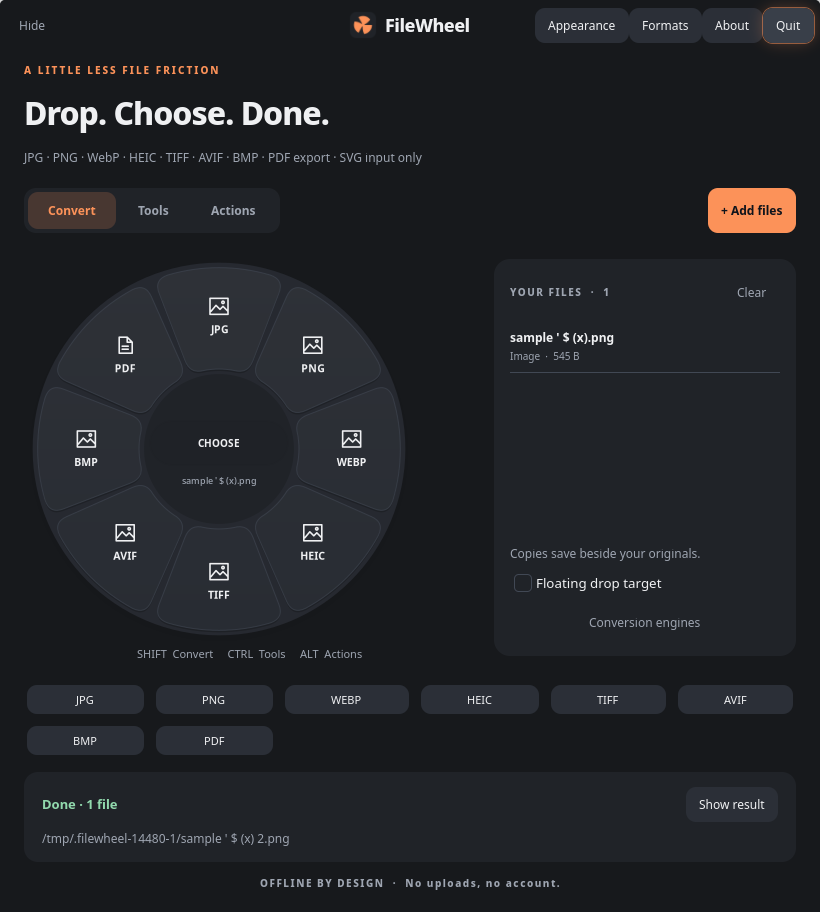

# FileWheel for Linux

A native **Rust + GTK4** desktop app for converting files and applying quick file tools. Rebuilt from the observed behavior of the original macOS FanDrop 0.1, with Linux conversion engines and desktop integration. The interface and icon are new; no macOS executable or Tangerine assets are bundled.



Run `filewheel` from a terminal or open **FileWheel** in your application launcher. Drag files from Dolphin onto the orange floating target at the right edge of the screen, then move onto a segment of the wheel and release. Dropping on the target itself stages the files in the main window. You can also choose **Add files**, drop directly onto the main wheel, or pass paths on the command line.

Choose **About** in the header to see the embedded FileWheel logo, app version, and **Created by Danny**. Close it with **×** or Escape. The version comes from the Cargo package metadata.

Use **Convert**, **Tools**, or **Actions** to switch menus. While pointing at a wheel or dragging over it, **Shift** selects Convert, **Ctrl** selects Tools, and **Alt** selects Actions. Arrow keys select a segment, Enter applies it, and Escape hides the floating wheel. The buttons below the main wheel provide keyboard-accessible versions of the same operations.

Outputs are saved beside the originals. Existing names receive a numeric suffix starting at 2. Jobs run in the background, show real errors, and can be cancelled. Quitting during a job cancels the current converter before exiting. **Trash** asks for confirmation and uses the desktop Trash.

| File type | Conversion formats | Tools |
| --- | --- | --- |
| Images | JPG, PNG, WebP, HEIC, TIFF, AVIF, BMP; PDF export; SVG input only | Resize to 1280, compress to JPEG, strip metadata, rotate, grayscale |
| Audio | MP3, M4A, WAV, FLAC, OGG (Vorbis), Opus, AIFF, WMA | Strip metadata, normalize, first 30 seconds, mono, compress |
| Video (including GIF) | MP4, MOV, MKV, WebM, AVI, WMV, GIF; MP3 export | Compress, strip metadata, mute, first 10 seconds, save frame |
| PDF | DOCX, PPTX, XLSX, JPG, PNG, EPUB, TXT, MD | All pages; JPG/PNG at 300 DPI; ZIP; optional qpdf metadata removal |
| Documents | DOCX, Markdown, TXT, EPUB; HTML export; Pages, RTF, RTFD and text clippings input | Copy text, copy word count, ZIP |
| Slides | PPT/PPTX → PDF, JPG, PNG; PPT input only | All slides; JPG/PNG at 300 DPI; ZIP, hashing |
| Spreadsheets | XLSX, ODS, CSV, TSV; PDF export; XLS input only | ZIP, hashing |
| Subtitles | SRT, VTT; TXT export without timestamps | ZIP, hashing |
| Archives | ZIP, TAR, GZIP (tar.gz); RAR input only | Repack members without extracting them; ZIP, hashing |
| Other files / folders | ZIP; folders also TAR/GZIP; SHA-256 for files | Archiving, hashing |

Open **Formats** in the header for the format reference and limitations. The subtitle also shows notes for the selected file family.

**Conversion details.** Pages export appears disabled with an explanation: Linux's LibreOffice engine can import supported Pages versions but cannot create Pages files ([LibreOffice guide](https://documentation.libreoffice.org/assets/Uploads/Documentation/en/GS7.3/GS73-GettingStarted.pdf)). Pages bundles are packaged for import. RTFD imports the bundle's RTF content; attachments are not preserved. Text clippings accept text/plist data or classic resource forks in AppleDouble `._` sidecars; include the sidecar when copying from macOS. EPUB import follows the spine reading order and EPUB export creates a valid EPUB 3 package; both use reflowed text and omit rich layout/images.

PDF DOCX/EPUB/TXT/MD exports extract embedded text without reconstructing the original layout. PDF XLSX places each extracted text line in one spreadsheet row; it does not recover tables or formulas. Scans require OCR before these text exports. PDF PPTX imports page objects through Impress; editability and fidelity depend on the source. JPG/PNG always export all pages at 300 DPI, including all slides for presentation inputs. CSV/TSV exports the first worksheet; other sheets remain in XLSX/ODS outputs. GZIP output is a gzip-compressed TAR archive (`.tar.gz`), and both standalone gzip files and compressed TAR input are supported. Original archive members are repacked without extraction to user folders.

Actions include **Copy path**, **Reveal**, **Open**, **Preview**, and **Trash**. Image and plain-text previews open inside FileWheel; video/audio use GTK's installed media backend. Other document previews use the default desktop application. Mixed selections expose common operations, falling back to ZIP/hashing where appropriate. Image compression makes a JPEG with a white background for transparency. Markdown uses LibreOffice’s Markdown import/export filter. Document layout and supported codecs depend on the installed engines.

**KDE Wayland integration.** The floating target and wheel use `gtk4-layer-shell`, which is supported on the tested KDE Wayland session. The tray icon opens the main window; its secondary action toggles the target. **Hide** keeps FileWheel running in the tray; **Quit** exits. `filewheel --background` starts just the floating target. Startup at login is not enabled automatically.

Wayland restricts observing another application's file drags. Bring the drag onto FileWheel's visible target to open the wheel. This build does not globally intercept Shift-drag anywhere on the desktop. On compositors without layer-shell support, the target uses a regular GTK window.

**Build and install.** Requires a Rust toolchain, GTK4 development files, and gtk4-layer-shell. On Arch, runtime/conversion packages are `gtk4`, `gtk4-layer-shell`, `imagemagick`, `ffmpeg`, `libreoffice-fresh` (or `libreoffice-still`), `poppler`, `libarchive`, `coreutils`, and `python` (standard-library adapters for EPUB, text clippings and gzip input). Optional `qpdf` enables PDF document metadata removal. Missing engines disable their operations and are shown under **Conversion engines**. At startup FileWheel also queries ImageMagick's read/write format support and FFmpeg's encoders, disabling image formats and explicit media presets whose required codecs are absent. These checks use bounded engine queries; runtime policies, input decoders, and tools using a container's default codec can still affect conversion. Restart FileWheel after changing engines or codecs.

```sh
cargo build --release --locked
bash install.sh
filewheel
```

The installer writes only to `~/.local/bin`, `~/.local/share/applications`, and `~/.local/share/icons`. No file associations are made the default. Core conversion jobs use executable paths and argument arrays without a shell. Job staging uses private temporary folders, reserves output names without replacing existing files, and cleans up failed/cancelled output. Cancellation and timeouts kill the converter's process group, including wrapper children. SHA-256, Copy text, and Word count stage in the system temporary directory, so they work with readable files in non-writable folders. File-producing operations still save beside the original.

Local diagnostics are at `${XDG_STATE_HOME:-~/.local/state}/filewheel/jobs.log`. New entries contain only the operation, source/output paths, and outcome. Clipboard contents, document text, and converter diagnostics are excluded. Logs from earlier builds are not rewritten and may contain previously copied text.

PDF metadata removal uses qpdf's [remove-info and remove-metadata options](https://qpdf.readthedocs.io/en/latest/cli.html#option-remove-info). It removes document-level Info/XMP metadata and is not a forensic sanitization tool; modification dates and metadata within page content may remain. That optional operation was unavailable on the development machine because qpdf was not installed.

**Verification.**

```sh
cargo test
python3 tests/formats_test.py
target/release/filewheel --self-test
FILEWHEEL_SCREENSHOT=/tmp/filewheel.png target/release/filewheel --smoke-test
```

Unit/import tests check file-family routing, input-only restrictions, missing engines/codecs, subtitle cue text, EPUB packages, macOS clipping resource forks, collision-safe output reservation, cancellation/timeouts with wrapper children, dotted office filenames, clipboard operations on read-only inputs, exclusion of document contents from the written job log, and radial hit-test boundaries/gaps. Run the Rust tests as an unprivileged user so filesystem permission regressions are meaningful. The self-test generates temporary fixtures and exercises the conversion presets and tools, multi-page PDF export, DOCX text round trips with dotted filenames, real clipboard operations in a non-writable folder, failed-conversion cleanup, original preservation, and filenames containing quotes and shell punctuation. The GTK smoke test exercises mode buttons, the actual GTK drop signal handler, asynchronous conversion, result display, and mapping the Wayland target/wheel. It does not synthesize a physical drag from Dolphin or test every media preview plugin.

Source layout: `src/engine.rs` handles capabilities and jobs; `src/main.rs` owns the UI, clipboard and desktop actions; `src/wheel.rs` draws and hit-tests the radial menu; `src/layer.rs` contains the small layer-shell FFI adapter; `src/smoke.rs` contains the real-file verification harness.
