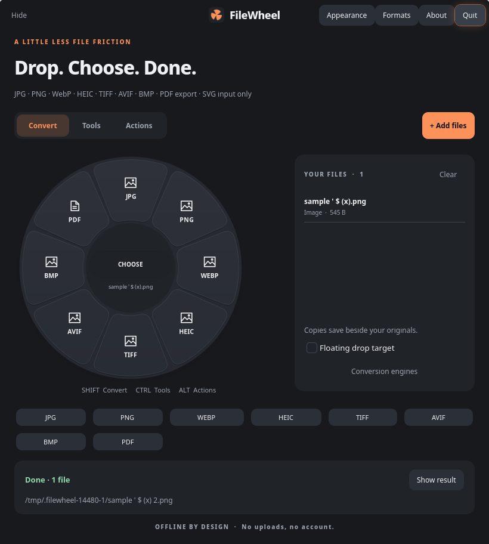
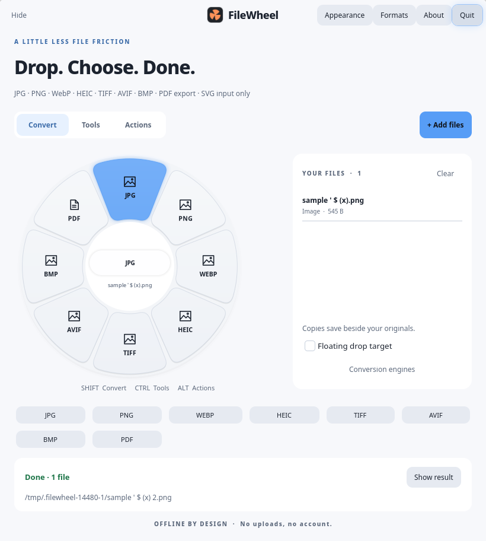
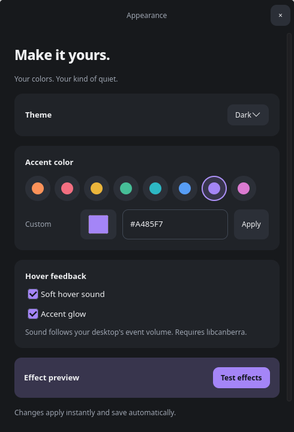

# FileWheel for Linux and Windows

A native **Rust + GTK4** desktop app for converting files and applying quick file tools. Rebuilt from the observed behavior of the original macOS FanDrop 0.1, with Linux conversion engines and desktop integration. A [Windows build](docs/WINDOWS.md) shares the same code, with an always-on-top drop target and a tray icon. The interface and icon are new; no macOS executable or Tangerine assets are bundled.

**🌐 [Visit the FileWheel Website](https://danny19862025.github.io/FileWheel/)** · **[Download for Windows](https://github.com/danny19862025/FileWheel/releases/latest)** · **[Download the Linux Flatpak](https://github.com/danny19862025/FileWheel/releases/tag/flatpak-full-test-1)** · [Installation instructions](#installation)



See [Installation](#installation) for step-by-step instructions for Windows and Linux. Drag files onto the orange floating target at the right edge of the screen, then move onto a segment of the wheel and release.

FileWheel opens with a 1.8-second logo reveal and warm light rings, followed by a typewriter animation of the header name. Click the intro or press Escape to skip. Desktop settings that disable GTK animations skip both effects. The Ribeye font and its OFL license are bundled in `data/fonts` and embedded in the binary.

Choose **About** in the header for the logo, version, **Created by Danny Rudd**, GitHub profile and project links, and release controls. **Check for updates** requests the latest stable GitHub release only when clicked (requires `curl`); **Releases** opens the download page. Close with **×**, **Close**, or Escape. The version comes from Cargo package metadata.

Choose **Appearance** to switch between **Dark**, **Light**, and **Follow system**. Pick one of eight accent colors, use the native color picker, or enter a `#RRGGBB` color. The window, wheel and floating target update immediately, with contrasting text chosen for your accent. **Restore defaults** returns to dark/orange.

The wheel uses rounded wedge buttons with soft shadows, icons above each label, and a pill in the center. Hovering an available operation highlights its wedge in your chosen accent. Gaps and cut-away corners do not activate operations when clicked or dropped onto. The Appearance window scrolls on smaller screens. Click **Test effects** to replay the enabled sound and briefly highlight the button; the caption shows which effects are being tested, or prompts you to enable one if both are off. See the [rounded buttons](docs/screenshots/filewheel-rounded-buttons.png) and [updated Appearance panel](docs/screenshots/filewheel-hover-preview.png).

Buttons and enabled wheel segments have a soft accent glow and a short, quiet hover sound. Turn either effect off under **Appearance → Hover feedback**. Sound is rate-limited, uses your desktop's event-audio volume, and needs optional `libcanberra`; the Nix package supplies it. Preferences save automatically to `${XDG_CONFIG_HOME:-~/.config}/filewheel/appearance.conf`. Follow system listens to the desktop settings portal and falls back to the initial GTK theme when that portal is unavailable.

| Light theme with blue accent | Appearance controls |
| --- | --- |
|  |  |

Use **Convert**, **Tools**, or **Actions** to switch menus. While pointing at a wheel or dragging over it, **Shift** selects Convert, **Ctrl** selects Tools, and **Alt** selects Actions. Arrow keys select a segment, Enter applies it, and Escape hides the floating wheel. The buttons below the main wheel provide keyboard-accessible versions of the same operations.

Outputs are saved beside the originals. Existing names receive a numeric suffix starting at 2. Jobs run in the background, show real errors, and can be cancelled. Quitting during a job cancels the current converter before exiting. **Trash** asks for confirmation and uses the desktop Trash.

| File type | Conversion formats | Tools |
| --- | --- | --- |
| Images | JPG, PNG, WebP, HEIC, TIFF, AVIF, BMP; PDF export; SVG input only | Resize to 1280, compress to JPEG, strip metadata, rotate, grayscale |
| Audio | MP3, M4A, WAV, FLAC, OGG (Vorbis), Opus, AIFF, WMA | Strip metadata, normalize, first 30 seconds, mono, compress |
| Video (including GIF) | MP4, MOV, MKV, WebM, AVI, WMV, GIF; MP3 export | Compress, strip metadata, mute, first 10 seconds, save frame |
| PDF | DOCX, PPTX, XLSX, JPG, PNG, EPUB, TXT, MD | All pages; JPG/PNG at 300 DPI; ZIP; optional qpdf metadata removal |
| Documents | DOCX, Markdown, TXT, EPUB; HTML export; Pages, RTF, RTFD and text clippings input | Copy text, copy word count, ZIP |
| Slides | PPT/PPTX → PDF, JPG, PNG; PPT input only | All slides; JPG/PNG at 300 DPI; ZIP, hashing |
| Spreadsheets | XLSX, ODS, CSV, TSV; PDF export; XLS input only | ZIP, hashing |
| Subtitles | SRT, VTT; TXT export without timestamps | ZIP, hashing |
| Archives | ZIP, TAR, GZIP (tar.gz); RAR input only | Repack members without extracting them; ZIP, hashing |
| Other files / folders | ZIP; folders also TAR/GZIP; SHA-256 for files | Archiving, hashing |

Open **Formats** in the header for the format reference and limitations. The subtitle also shows notes for the selected file family.

**Conversion details.** Pages export appears disabled with an explanation: Linux's LibreOffice engine can import supported Pages versions but cannot create Pages files ([LibreOffice guide](https://documentation.libreoffice.org/assets/Uploads/Documentation/en/GS7.3/GS73-GettingStarted.pdf)). Pages bundles are packaged for import. RTFD imports the bundle's RTF content; attachments are not preserved. Text clippings accept text/plist data or classic resource forks in AppleDouble `._` sidecars; include the sidecar when copying from macOS. EPUB import follows the spine reading order and EPUB export creates a valid EPUB 3 package; both use reflowed text and omit rich layout/images.

PDF DOCX/EPUB/TXT/MD exports extract embedded text without reconstructing the original layout. PDF XLSX places each extracted text line in one spreadsheet row; it does not recover tables or formulas. Scans require OCR before these text exports. PDF PPTX imports page objects through Impress; editability and fidelity depend on the source. JPG/PNG always export all pages at 300 DPI, including all slides for presentation inputs. CSV/TSV exports the first worksheet; other sheets remain in XLSX/ODS outputs. GZIP output is a gzip-compressed TAR archive (`.tar.gz`), and both standalone gzip files and compressed TAR input are supported. Original archive members are repacked without extraction to user folders.

Actions include **Copy path**, **Reveal**, **Open**, **Preview**, and **Trash**. Image and plain-text previews open inside FileWheel; video/audio use GTK's installed media backend. Other document previews use the default desktop application. Mixed selections expose common operations, falling back to ZIP/hashing where appropriate. Image compression makes a JPEG with a white background for transparency. Markdown uses LibreOffice’s Markdown import/export filter. Document layout and supported codecs depend on the installed engines.

**KDE Wayland integration.** The floating target and wheel use `gtk4-layer-shell`, which is supported on the tested KDE Wayland session. The tray icon opens the main window; its secondary action toggles the target. **Hide** keeps FileWheel running in the tray; **Quit** exits. Without a tray (for example GNOME without an AppIndicator extension), closing the window quits and **Hide** minimizes instead. `filewheel --background` starts just the floating target. Startup at login is not enabled automatically.

Wayland restricts observing another application's file drags. Bring the drag onto FileWheel's visible target to open the wheel. This build does not globally intercept Shift-drag anywhere on the desktop. On compositors without layer-shell support, the target uses a regular GTK window.

## Installation

| Platform | Easiest option | Other options |
| --- | --- | --- |
| **Windows 10/11** (x86_64) | [Windows installer (`FileWheel-Setup-x86_64.exe`)](#windows-installer-recommended) | [Portable ZIP](#windows-portable-zip) · [Build from source](#windows-build-from-source) |
| **Linux** (x86_64) | [Flatpak test release](#linux-flatpak-test-release) | [Native build from source](#linux-native-build-from-source) · [Nix / NixOS](docs/NIXOS.md) |

FileWheel converts files with free conversion engines (ImageMagick, FFmpeg,
LibreOffice and others). Every engine is optional: FileWheel starts without
them, disables only the operations that need a missing engine, and lists what is
missing under **Conversion engines** in the app. Restart FileWheel after
installing an engine.

### Windows

Requires Windows 10 version 1809 or later, or Windows 11, on x86_64.

#### Windows installer (recommended)

1. Download **`FileWheel-Setup-x86_64.exe`** from the
   [latest release](https://github.com/danny19862025/FileWheel/releases/latest).
2. Double-click it. Windows SmartScreen may warn because the installer is not
   code-signed: choose **More info → Run anyway**.
3. Follow the wizard. No administrator rights are needed: FileWheel installs
   for your account into `%LOCALAPPDATA%\Programs\FileWheel`. Optionally tick
   **Create a desktop shortcut** and **Start the FileWheel drop target when I
   sign in**.
4. Open **FileWheel** from the Start menu.

To verify the download first, compare its hash with
`FileWheel-windows-SHA256SUMS.txt` from the same release:

```powershell
Get-FileHash .\FileWheel-Setup-x86_64.exe -Algorithm SHA256
```

**Uninstall:** Settings → Apps → Installed apps → FileWheel → Uninstall. Your
settings in `%APPDATA%\FileWheel` are kept; delete that folder and
`%LOCALAPPDATA%\FileWheel` to remove them too.

**Silent install** (for scripts):
`FileWheel-Setup-x86_64.exe /VERYSILENT /SUPPRESSMSGBOXES /CURRENTUSER`.

#### Windows portable ZIP

1. Download **`FileWheel-windows-x86_64.zip`** from the
   [latest release](https://github.com/danny19862025/FileWheel/releases/latest).
2. Right-click it → **Extract All…**, for example to
   `C:\Users\<you>\Apps\FileWheel`.
3. Run `FileWheel.exe` inside the extracted folder.

Nothing is registered. To remove it, quit FileWheel and delete the folder.

#### Windows conversion engines

Open **PowerShell** or **Command Prompt** and install the engines you want with
`winget` (built into Windows 10/11):

```powershell
winget install -e --id ImageMagick.ImageMagick
winget install -e --id Gyan.FFmpeg
winget install -e --id TheDocumentFoundation.LibreOffice
winget install -e --id oschwartz10612.Poppler
winget install -e --id Python.Python.3.13
winget install -e --id QPDF.QPDF
```

| Engine | Used for |
| --- | --- |
| ImageMagick | Image conversion and image tools |
| FFmpeg | Audio, video, GIF and subtitle conversion |
| LibreOffice | Documents, slides, spreadsheets, PDF → DOCX/PPTX/XLSX |
| Poppler | PDF → JPG/PNG/TXT/MD, slides → images |
| Python 3 | EPUB, text clippings and gzip input |
| QPDF | PDF metadata removal (optional) |

ZIP/TAR/GZIP use the `tar.exe` built into Windows, and SHA-256 needs no engine.
FileWheel finds engines on `PATH` and in their default install folders, so you
only need to restart FileWheel, not sign out.

#### Using FileWheel on Windows

Drag files from File Explorer onto the orange always-on-top target at the right
edge of the screen, then onto a wheel segment. The tray icon opens FileWheel;
right-click it for **Show/hide drop target** and **Quit**. Closing the main
window keeps FileWheel running in the tray. More details: [Windows guide](docs/WINDOWS.md).

#### Windows: build from source

Install [MSYS2](https://www.msys2.org/), open the **MSYS2 UCRT64** shell, and run:

```bash
pacman -S --needed git zip mingw-w64-ucrt-x86_64-{gtk4,rust,pkgconf,gcc}
git clone https://github.com/danny19862025/FileWheel.git
cd FileWheel
cargo build --release --locked
bash packaging/windows/package.sh
```

This produces the portable folder `dist/FileWheel` and
`dist/FileWheel-windows-x86_64.zip`. To also build the installer, install
[Inno Setup 6](https://jrsoftware.org/isdl.php) and run from PowerShell in the
repository folder:

```powershell
& "${env:ProgramFiles(x86)}\Inno Setup 6\ISCC.exe" /DAppVersion=0.1.0 packaging\windows\FileWheel.iss
```

The installer is written to `dist\FileWheel-Setup-x86_64.exe`.

### Linux

#### Linux: Flatpak test release

A prebuilt **x86_64 Flatpak** is available from the
[GitHub test release](https://github.com/danny19862025/FileWheel/releases/tag/flatpak-full-test-1).
No compilation is required. This is a pre-release, not a Flathub listing.

1. Install Flatpak for your distribution (see
   [flatpak.org/setup](https://flatpak.org/setup/)).
2. Download `FileWheel-full-test-x86_64.flatpak` and
   `FileWheel-full-test-x86_64.flatpak.sha256` from that release into
   `~/Downloads`.
3. Verify the download and continue only if it reports **OK**:

   ```sh
   cd ~/Downloads
   sha256sum -c FileWheel-full-test-x86_64.flatpak.sha256
   ```

4. Add Flathub for the shared GNOME runtime, then install and launch FileWheel:

   ```sh
   flatpak remote-add --user --if-not-exists flathub https://flathub.org/repo/flathub.flatpakrepo
   flatpak install --user flathub org.gnome.Platform//51
   flatpak install --user ~/Downloads/FileWheel-full-test-x86_64.flatpak
   flatpak run --user --branch=full-test io.github.danny19862025.FileWheel
   ```

The package has home-folder access to save outputs beside originals.
Document-to-PDF, PDF-to-PNG/text and image-to-AVIF conversions have been tested
by the maintainer on a desktop and laptop; this does not cover every input file
or desktop environment. Check the release page manually for newer test builds;
the app's update checker does not list pre-releases. To remove it:
`flatpak uninstall --user io.github.danny19862025.FileWheel`.

#### Linux: native build from source

**1. Install the dependencies.** You need current stable Rust, **GTK ≥ 4.10**
and **Pango ≥ 1.56** development files, **gtk4-layer-shell**, and the
conversion engines. Common distributions:

Arch, EndeavourOS, CachyOS, Manjaro:

```sh
sudo pacman -Syu --needed base-devel git rust gtk4 gtk4-layer-shell \
  desktop-file-utils xdg-utils imagemagick ffmpeg libreoffice-fresh \
  poppler libarchive python coreutils qpdf ttf-dejavu
```

Ubuntu 26.04+ and derivatives, Debian 13+:

```sh
sudo apt update
sudo apt install build-essential git cargo rustc pkg-config \
  libgtk-4-dev libgtk4-layer-shell-dev desktop-file-utils xdg-utils \
  imagemagick ffmpeg libreoffice poppler-utils libarchive-tools \
  python3 coreutils qpdf fonts-dejavu-core
```

Fedora:

```sh
sudo dnf install gcc git rust cargo pkgconf-pkg-config \
  gtk4-devel gtk4-layer-shell-devel desktop-file-utils xdg-utils \
  ImageMagick ffmpeg-free libreoffice-writer libreoffice-calc \
  libreoffice-impress poppler-utils bsdtar python3 coreutils qpdf \
  dejavu-sans-fonts
```

Gentoo, openSUSE, Void, Alpine, immutable desktops (Bazzite, SteamOS, Fedora
Atomic), enterprise distributions, and older Ubuntu/Debian releases are covered
in the [Linux distribution guide](docs/INSTALL.md). On NixOS or any distribution
with Nix, use the [flake guide](docs/NIXOS.md) or simply
`nix run github:danny19862025/FileWheel`.

If your distribution's Rust is too old for the locked dependencies, install
current stable Rust with [rustup](https://rust-lang.org/tools/install/) and open
a new terminal. Image conversion needs **ImageMagick 7** (`magick`);
ImageMagick 6 is not compatible.

**2. Clone and install:**

```sh
git clone https://github.com/danny19862025/FileWheel.git
cd FileWheel
bash install.sh
```

`install.sh` builds the release binary and installs it for your user only, to
`~/.local/bin/filewheel`, plus a launcher in `~/.local/share/applications` and an
icon in `~/.local/share/icons`. No `sudo` and no separate `cargo build` are
needed, and no file associations are changed.

**3. Run it** from your application launcher (**FileWheel**), or from a terminal:

```sh
"$HOME/.local/bin/filewheel"
```

If `~/.local/bin` is on your `PATH`, `filewheel` also works.
`filewheel --background` starts just the floating drop target.

**Update:** inside the `FileWheel` folder run `git pull && bash install.sh`.

**Uninstall:**

```sh
rm -f ~/.local/bin/filewheel \
  ~/.local/share/applications/local.danny.FileWheel.desktop \
  ~/.local/share/icons/hicolor/scalable/apps/filewheel.svg
rm -rf ~/.config/filewheel ~/.local/state/filewheel   # optional: settings and logs
```

#### Using FileWheel on Linux

Drag files from your file manager onto the orange floating target at the right
edge of the screen, then move onto a segment of the wheel and release. Dropping
on the target itself stages the files in the main window. You can also choose
**Add files**, drop directly onto the main wheel, or pass paths on the command
line.

## Technical notes

On Linux, `install.sh` writes only to `~/.local/bin`, `~/.local/share/applications`, and `~/.local/share/icons`. No file associations are made the default. Core conversion jobs use executable paths and argument arrays without a shell. Job staging uses private temporary folders, reserves output names without replacing existing files, and cleans up failed/cancelled output. Cancellation and timeouts kill the converter's process group, including wrapper children. SHA-256, Copy text, and Word count stage in the system temporary directory, so they work with readable files in non-writable folders. File-producing operations still save beside the original.

Local diagnostics are at `${XDG_STATE_HOME:-~/.local/state}/filewheel/jobs.log`. New entries contain only the operation, source/output paths, and outcome. Clipboard contents, document text, and converter diagnostics are excluded. Logs from earlier builds are not rewritten and may contain previously copied text.

PDF metadata removal uses qpdf's [remove-info and remove-metadata options](https://qpdf.readthedocs.io/en/latest/cli.html#option-remove-info). It removes document-level Info/XMP metadata and is not a forensic sanitization tool; modification dates and metadata within page content may remain. That optional operation was unavailable on the development machine because qpdf was not installed.

**Verification.**

```sh
cargo test
python3 tests/formats_test.py
target/release/filewheel --self-test
FILEWHEEL_SCREENSHOT=/tmp/filewheel.png target/release/filewheel --smoke-test
target/release/filewheel --sound-test
```

Unit/import tests check file-family routing, input-only restrictions, missing engines/codecs, subtitle cue text, EPUB packages, macOS clipping resource forks, collision-safe output reservation, cancellation/timeouts with wrapper children, dotted office filenames, clipboard operations on read-only inputs, exclusion of document contents from the written job log, and radial hit-test boundaries/gaps. Run the Rust tests as an unprivileged user so filesystem permission regressions are meaningful. The self-test generates temporary fixtures and exercises the conversion presets and tools, multi-page PDF export, DOCX text round trips with dotted filenames, real clipboard operations in a non-writable folder, failed-conversion cleanup, original preservation, and filenames containing quotes and shell punctuation. The GTK smoke test exercises mode buttons, the actual GTK drop signal handler, asynchronous conversion, result display, and mapping the Wayland target/wheel. It does not synthesize a physical drag from Dolphin or test every media preview plugin.

Appearance regressions check saved preferences, invalid custom colors and text contrast. The GTK smoke also exercises theme/preset/custom-color changes, saved hover toggles, system-mode changes, reset, hover-controller routing and reopening the Appearance window, using an isolated temporary settings file. `--sound-test` plays one short hover cue through the real desktop audio backend.

Source layout: `src/engine.rs` handles capabilities and jobs; `src/main.rs` owns the UI, clipboard and desktop actions; `src/wheel.rs` draws and hit-tests the radial menu; `src/layer.rs` contains the small layer-shell FFI adapter; `src/smoke.rs` contains the real-file verification harness.
